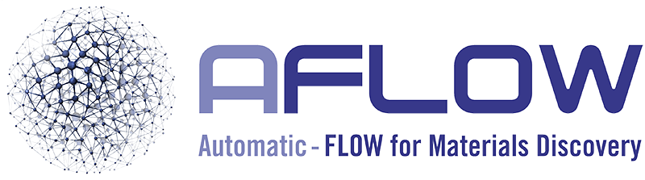
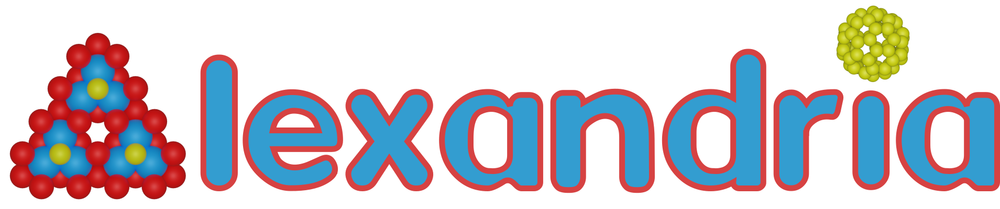

# 🎉 PsiCrawler

<p align="center">
  <a href="./README.md">English</a> |
  <a href="./README_zh.md">简体中文</a>
</p>

## 🚀 Project Overview

PsiCrawler is a research data crawling, normalization, storage, and retrieval project. It is designed to batch collect publicly accessible DFT calculation databases, paper databases, scientific datasets, and related experimental records from the open web.

## 🔥 Latest Updates

- 2026-10-09 Added a 2DMatPedia (two-dimensional materials) adapter with single JSON Lines bulk ingestion, normalized DFT records, and SQLite indexing.
- 2026-10-09 Added a MatPES (potential energy surface) adapter with streamed PBE/r2SCAN JSON Lines ingestion from Hugging Face (mirror via `HF_ENDPOINT`), normalized DFT records, and SQLite indexing.
- 2026-10-09 Added a QMOF (Quantum MOF Database) adapter that joins the property table with the relaxed-structure archive, normalized DFT records, and SQLite indexing.
- 2026-10-09 Added a Catalysis-Hub adapter with GraphQL cursor paging over the `systems` table (requires `CATALYSIS_HUB_API_KEY`), normalized DFT records, and SQLite indexing.
- 2026-09-23 Added an AMCSD (American Mineralogist Crystal Structure Database) adapter with official bulk CIF/AMC/DIF archive ingestion, experimental mineral crystal structures normalized into the DFT contract, and SQLite indexing.
- 2026-09-18 Added a NOMAD Archive adapter with native API entry enumeration, per-entry processed archive ingestion, bulk zip ingestion, SI-to-standard unit conversion, normalized DFT records, and SQLite indexing.
- 2026-09-16 Added a Materials Cloud adapter with OPTIMADE paging for MC3D (PBE/PBEsol) and MC2D, curated archive bulk downloads, normalized DFT records, and SQLite indexing.
- 2026-09-13 Added an Alexandria (AMD) adapter with streamed bulk JSON.bz2 ingestion, OPTIMADE on-demand queries, dataset-namespaced identifiers, normalized DFT records, and SQLite indexing.
- 2026-09-10 Added a schema-driven Materials Project adapter with source-specific API access, 26 material routes, complete Summary capture, route-specific queries, CIF export, normalized records, and SQLite indexing.
- 2026-09-10 Added an AFLOW adapter with categorized raw storage, normalized DFT records, property-path tracking, and SQLite indexing.
- 2026-09-10 AFLOW XZ artifacts are decompressed into their original directories after download, and the compressed files are removed after successful conversion.
- 2026-09-10 Downloaded data is stored locally under `data/` and excluded from Git.
- 2026-09-10 Added single-record and batch crawling entrypoints for Materials Project.

## 🌟 Quick Start

Install the dependencies:

```powershell
pip install -r requirements.txt
```

Configure the environment:

```powershell
Copy-Item .env.example .env
```

Edit `.env`:

- `MP_API_KEY`: Materials Project key (required by the MP adapter)
- `HF_ENDPOINT`: Hugging Face endpoint; set to `https://hf-mirror.com` when the default host is unreachable (MatPES, QMOF)
- `CATALYSIS_HUB_API_KEY`: free Catalysis-Hub key ([obtain one here](https://api-catalysis-hub.slac.stanford.edu/auth/login))

Materials Project single and batch:

```powershell
python -m crawler.dft.mp.run_single mp-149
python -m crawler.dft.mp.run_batch --mp-ids mp-149,mp-13,mp-22526 --sleep 1
```

Other DFT sources (single):

```powershell
python -m crawler.dft.twodmatpedia.run_single 2dm-1
python -m crawler.dft.matpes.run_single matpes-20240214_999485_2 --max-scan 1000
python -m crawler.dft.qmof.run_single qmof-8a95c27
python -m crawler.dft.catalysishub.run_single 68351
```

Limited-sample runs first (recommended):

```powershell
python -m tests.dft.twodmatpedia.extract_batch --max-records 5
python -m tests.dft.matpes.extract_batch --max-records 5
python -m tests.dft.qmof.extract_batch --max-records 5
python -m tests.dft.catalysishub.extract_batch --max-records 5
```

## 📚 Data Sources

### 🧪 DFT Databases

DFT sources are implemented separately because each database has different APIs, material identifiers, document models, fields, pagination rules, and data licenses.

Overview: [DFT Sources](./document/dft/overview.md)

The unified DFT field definitions, categories, units, enum values, and null-value conventions are documented in the shared contract [`normalizers/dft/standard.yaml`](./normalizers/dft/standard.yaml).

#### Materials Project


Materials Project is a large computational materials database for crystal structures, thermodynamic properties, electronic structure, magnetic and mechanical properties, synthesis information, provenance, and related materials metadata.

Official website: [materialsproject.org](https://materialsproject.org/)

Local Source: [Materials Project](./document/dft/mp.md)

#### AFLOW



AFLOW provides high-throughput computational materials data, including structural, thermodynamic, electronic, magnetic, elastic, and related calculation outputs.

Official website: [aflow.org](https://aflow.org/)

Local Source: [AFLOW](./document/dft/aflow.md)

#### Alexandria (AMD)



Alexandria is an open high-throughput database of DFT-relaxed inorganic crystals, with PBE, PBEsol, and SCAN geometries, convex hulls, phonons, benchmarks, and the generative models trained on them. The adapter streams the bulk `*.json.bz2` archives entry by entry and can also query the OPTIMADE API on demand.

Official website: [alexandria.icams.rub.de](https://alexandria.icams.rub.de/)

Local Source: [Alexandria](./document/dft/alexandria.md)

#### Materials Cloud


Materials Cloud is an open-science platform hosting curated computational materials databases, including the 3D structure database (MC3D) and the 2D database (MC2D). The adapter pages their OPTIMADE APIs and can preserve the curated archive bulk artifacts.

Official website: [materialscloud.org](https://www.materialscloud.org/)

Local Source: [Materials Cloud](./document/dft/materialscloud.md)

#### NOMAD Archive


NOMAD is an open FAIR data platform whose public Archive aggregates processed computational results from many codes and mirrors external databases such as AFLOW. The adapter enumerates public entries through the native API, fetches each processed archive document (or a bulk zip), converts SI units into the standard contract, and indexes normalized DFT records.

Official website: [nomad-lab.eu](https://nomad-lab.eu/)

Local Source: [NOMAD Archive](./document/dft/nomad.md)

#### AMCSD


The American Mineralogist Crystal Structure Database (AMCSD) is an experimental crystal structure database focused on minerals and solids of interest to mineralogists, published by the RRUFF project. The adapter ingests the official bulk CIF, AMC, and DIF archives, aligns records by AMCSD identifier, and normalizes them as experimental structures.

Official website: [rruff.net/amcsd](https://www.rruff.net/amcsd/)

Local Source: [AMCSD](./document/dft/amcsd.md)

#### OQMD

OQMD provides computed materials properties for inorganic compounds, with a focus on formation energies, phase stability, structures, and composition-based search.

Official website: [oqmd.org](https://oqmd.org/)

Local Source: [OQMD](./document/dft/oqmd.md)

#### 2DMatPedia

2DMatPedia is an open computational database of two-dimensional materials from top-down exfoliation and bottom-up chemical substitution, produced by the Centre for Advanced 2D Materials (National University of Singapore).

Official website: [2dmatpedia.org](https://www.2dmatpedia.org/)

Local Source: [2DMatPedia](./document/dft/twodmatpedia.md)

#### MatPES

MatPES (Materials Potential Energy Surface) is an open potential-energy-surface dataset from Materialyze.AI and the Materials Project, computed with PBE and r2SCAN and designed to train foundation interatomic potentials.

Official website: [matpes.ai](https://matpes.ai/)

Local Source: [MatPES](./document/dft/matpes.md)

#### QMOF

The Quantum MOF (QMOF) Database provides quantum-chemical properties for 20,000+ metal-organic frameworks from high-throughput periodic DFT, including PBE, HSE06, and HLE17 band gaps.

Official website: [github.com/Andrew-S-Rosen/QMOF](https://github.com/Andrew-S-Rosen/QMOF)

Local Source: [QMOF](./document/dft/qmof.md)

#### Catalysis-Hub

Catalysis-Hub is an open surface-reaction database maintained by the SUNCAT Center, backed by an ASE database whose `systems` table holds slab and adsorbate structures, total energies, and embedded CIFs. The adapter pages it through GraphQL (a free API key is required).

Official website: [catalysis-hub.org](https://www.catalysis-hub.org/)

Local Source: [Catalysis-Hub](./document/dft/catalysishub.md)

---

### 📝 Paper Databases

Paper sources are also implemented separately because each service exposes different metadata, identifiers, citation relationships, full-text links, access rules, and rate limits.

Overview: [Paper Sources](./document/papers/overview.md)

#### arXiv

arXiv provides open-access preprint metadata and links for papers across physics, mathematics, computer science, quantitative biology, and related fields.

Official website: [arxiv.org](https://arxiv.org/)

Local Source: [arXiv](./document/papers/arxiv.md)

#### Crossref

Crossref provides DOI-centered scholarly metadata, including titles, authors, publishers, journals, publication dates, references, and related identifiers.

Official website: [crossref.org](https://www.crossref.org/)

Local Source: [Crossref](./document/papers/crossref.md)

#### OpenAlex

OpenAlex provides open scholarly metadata for works, authors, institutions, venues, concepts, citations, and open-access links.

Official website: [openalex.org](https://openalex.org/)

Local Source: [OpenAlex](./document/papers/openalex.md)

## ⚖️ Compliance

PsiCrawler is intended only for public web pages, public APIs, and openly accessible data resources. Users should follow the target site's terms of service, copyright policy, data license, citation requirements, robots.txt rules, rate limits, and applicable laws.
