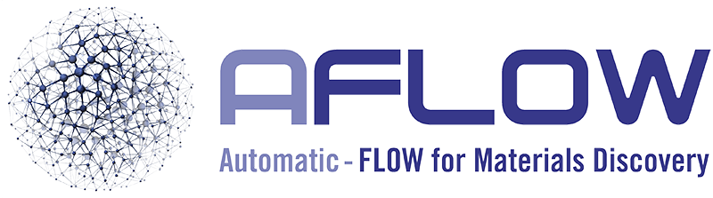
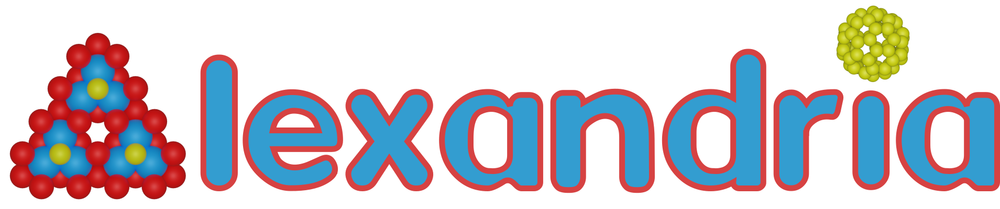

# 🎉 PsiCrawler

<p align="center">
  <a href="./README.md">English</a> |
  <a href="./README_zh.md">简体中文</a>
</p>

## 🚀 项目概览

PsiCrawler 是一个用于科研数据采集、标准化、存储和检索的项目，面向公开网络上的 DFT 计算数据库、论文数据库、科学数据集以及相关实验记录进行批量采集。

## 🔥 最新进展

- 2026-10-09：新增 2DMatPedia（二维材料）适配器，整库 JSON Lines 流式采集、标准化 DFT 记录与 SQLite 索引。
- 2026-10-09：新增 MatPES（势能面数据集）适配器，支持 PBE/r2SCAN 两种泛函的 Hugging Face JSON Lines 流式采集（可用 `HF_ENDPOINT` 指向镜像），标准化 DFT 记录与 SQLite 索引。
- 2026-10-09：新增 QMOF（金属有机框架量子化学数据库）适配器，采集属性表与弛豫结构归档并逐条关联 CIF，标准化 DFT 记录与 SQLite 索引。
- 2026-10-09：新增 Catalysis-Hub（表面催化）适配器，通过 GraphQL 游标分页采集 `systems` 表，标准化 DFT 记录与 SQLite 索引（需要 `CATALYSIS_HUB_API_KEY`）。
- 2026-09-23：新增 AMCSD（美国矿物学家晶体结构数据库）适配器，支持官方 CIF/AMC/DIF 批量归档采集、将实验矿物晶体结构标准化到 DFT 契约并写入 SQLite 索引。
- 2026-09-18：新增 NOMAD Archive 适配器，支持原生 API 条目枚举、逐条处理态归档采集、批量 zip 采集、SI 到标准单位换算、标准化 DFT 记录和 SQLite 索引。
- 2026-09-16：新增 Materials Cloud 适配器，支持 MC3D（PBE/PBEsol）和 MC2D 的 OPTIMADE 分页采集、精选归档批量包下载、标准化 DFT 记录和 SQLite 索引。
- 2026-09-13：新增 Alexandria (AMD) 适配器，支持流式批量 JSON.bz2 采集、OPTIMADE 按需查询、数据集命名空间标识符、标准化 DFT 记录和 SQLite 索引。
- 2026-09-10：新增基于 schema 驱动的 Materials Project 适配器，支持数据源专用 API、26 个材料接口、完整 Summary 字段采集、按接口查询、CIF 导出、标准化记录和 SQLite 索引。
- 2026-09-10：新增 AFLOW 适配器，支持分类原始数据存储、标准化 DFT 记录、性质路径记录和 SQLite 索引。
- 2026-09-10：AFLOW 的 XZ 文件会在下载后解压到原对应目录，转换成功后删除压缩文件。
- 2026-09-10：下载数据保存在 `data/` 目录中，并已从 Git 跟踪中排除。
- 2026-09-10：新增 Materials Project 单条和批量爬取入口。

## 🌟 快速开始

安装依赖：

```powershell
pip install -r requirements.txt
```

配置环境变量：

```powershell
Copy-Item .env.example .env
```

编辑 `.env`：

- `MP_API_KEY`：Materials Project 密钥（MP 适配器必需）
- `HF_ENDPOINT`：Hugging Face 端点；默认地址受限时设为 `https://hf-mirror.com`（MatPES、QMOF）
- `CATALYSIS_HUB_API_KEY`：Catalysis-Hub 免费密钥（[获取地址](https://api-catalysis-hub.slac.stanford.edu/auth/login)）

Materials Project 单条与批量：

```powershell
python -m crawler.dft.mp.run_single mp-149
python -m crawler.dft.mp.run_batch --mp-ids mp-149,mp-13,mp-22526 --sleep 1
```

其余 DFT 源（单条）：

```powershell
python -m crawler.dft.twodmatpedia.run_single 2dm-1
python -m crawler.dft.matpes.run_single matpes-20240214_999485_2 --max-scan 1000
python -m crawler.dft.qmof.run_single qmof-8a95c27
python -m crawler.dft.catalysishub.run_single 68351
```

先跑限量样例（推荐）：

```powershell
python -m tests.dft.twodmatpedia.extract_batch --max-records 5
python -m tests.dft.matpes.extract_batch --max-records 5
python -m tests.dft.qmof.extract_batch --max-records 5
python -m tests.dft.catalysishub.extract_batch --max-records 5
```

## 📚 数据源

### 🧪 DFT 数据库

不同 DFT 数据库具有不同的 API、材料标识符、文档模型、字段、分页规则和数据许可，因此各数据源分别实现。

概览：[DFT 数据源](./document/dft/overview.md)

统一 DFT 字段、字段分类、单位、枚举值和空值约定见共享契约 [`normalizers/dft/standard.yaml`](./normalizers/dft/standard.yaml)。

#### Materials Project


Materials Project 是大型计算材料数据库，提供晶体结构、热力学性质、电子结构、磁性和力学性质、合成信息、数据来源以及相关材料元数据。

官方网站：[materialsproject.org](https://materialsproject.org/)

本地数据源说明：[Materials Project](./document/dft/mp.md)

#### AFLOW



AFLOW 提供高通量计算材料数据，包括结构、热力学、电子、磁性、弹性以及其他相关计算输出。

官方网站：[aflow.org](https://aflow.org/)

本地数据源说明：[AFLOW](./document/dft/aflow.md)

#### Alexandria (AMD)



Alexandria 是一个开放的高通量 DFT 无机晶体数据库，包含 PBE、PBEsol 和 SCAN 几何结构、凸包、声子、基准数据以及基于这些数据训练的生成模型。适配器逐条流式读取批量 `*.json.bz2` 归档，也可通过 OPTIMADE API 按需查询。

官方网站：[alexandria.icams.rub.de](https://alexandria.icams.rub.de/)

本地数据源说明：[Alexandria](./document/dft/alexandria.md)

#### Materials Cloud


Materials Cloud 是一个开放科学平台，托管精选的计算材料数据库，包括三维结构数据库（MC3D）和二维数据库（MC2D）。适配器分页其 OPTIMADE API，并可保留精选归档批量文件。

官方网站：[materialscloud.org](https://www.materialscloud.org/)

本地数据源说明：[Materials Cloud](./document/dft/materialscloud.md)

#### NOMAD Archive


NOMAD 是一个开放的 FAIR 数据平台，其公开 Archive 聚合了来自多种计算程序的处理态结果，并镜像了 AFLOW 等外部数据库。适配器通过原生 API 枚举公开条目，逐条抓取处理态归档文档（或批量 zip），将 SI 单位换算到标准契约并索引标准化 DFT 记录。

官方网站：[nomad-lab.eu](https://nomad-lab.eu/)

本地数据源说明：[NOMAD Archive](./document/dft/nomad.md)

#### AMCSD


美国矿物学家晶体结构数据库（AMCSD）是由 RRUFF 项目维护的实验晶体结构数据库，面向矿物及矿物学家关注的相关固相。适配器采集官方 CIF、AMC、DIF 批量归档，按 AMCSD 标识符对齐记录，并按实验结构进行标准化。

官方网站：[rruff.net/amcsd](https://www.rruff.net/amcsd/)

本地数据源说明：[AMCSD](./document/dft/amcsd.md)

#### OQMD

OQMD 提供无机化合物的计算材料性质，重点包括形成能、相稳定性、结构和基于组成的检索。

官方网站：[oqmd.org](https://oqmd.org/)

本地数据源说明：[OQMD](./document/dft/oqmd.md)

#### 2DMatPedia

2DMatPedia 是由新加坡国立大学先进二维材料中心构建的开放二维材料计算数据库，包含自上而下剥离与自下而上化学取代得到的结构与性质。

官方网站：[2dmatpedia.org](https://www.2dmatpedia.org/)

本地数据源说明：[2DMatPedia](./document/dft/twodmatpedia.md)

#### MatPES

MatPES（Materials Potential Energy Surface）由 Materialyze.AI 与 Materials Project 构建，提供覆盖周期表的 PBE 与 r2SCAN 静态 DFT 势能面数据，用于训练基础原子间势。

官方网站：[matpes.ai](https://matpes.ai/)

本地数据源说明：[MatPES](./document/dft/matpes.md)

#### QMOF

QMOF（Quantum MOF Database）是金属有机框架与配位聚合物的量子化学性质数据库，包含周期性 DFT（PBE-D3BJ）结构、能量与带隙，以及 HSE06、HLE17 带隙。

官方网站：[github.com/Andrew-S-Rosen/QMOF](https://github.com/Andrew-S-Rosen/QMOF)

本地数据源说明：[QMOF](./document/dft/qmof.md)

#### Catalysis-Hub

Catalysis-Hub 是由 SUNCAT 中心维护的开放表面反应数据库，后端为 ASE 数据库，`systems` 表保存 slab 与吸附物的结构、总能量和内嵌 CIF。适配器通过 GraphQL 游标分页采集（需要免费 API key）。

官方网站：[catalysis-hub.org](https://www.catalysis-hub.org/)

本地数据源说明：[Catalysis-Hub](./document/dft/catalysishub.md)

---

### 📝 论文数据库

不同论文服务提供不同的元数据、标识符、引用关系、全文链接、访问规则和速率限制，因此论文来源也分别实现。

概览：[论文数据源](./document/papers/overview.md)

#### arXiv

arXiv 提供物理、数学、计算机科学、定量生物学及相关领域论文的开放预印本元数据和链接。

官方网站：[arxiv.org](https://arxiv.org/)

本地数据源说明：[arXiv](./document/papers/arxiv.md)

#### Crossref

Crossref 提供以 DOI 为中心的学术元数据，包括标题、作者、出版商、期刊、发表日期、参考文献和相关标识符。

官方网站：[crossref.org](https://www.crossref.org/)

本地数据源说明：[Crossref](./document/papers/crossref.md)

#### OpenAlex

OpenAlex 提供开放的学术元数据，包括论文、作者、机构、出版物、概念、引用关系和开放获取链接。

官方网站：[openalex.org](https://openalex.org/)

本地数据源说明：[OpenAlex](./document/papers/openalex.md)

## ⚖️ 合规说明

PsiCrawler 仅用于公开网页、公开 API 和开放获取的数据资源。使用者应遵守目标网站的服务条款、版权政策、数据许可、引用要求、robots.txt 规则、速率限制以及适用法律法规。
